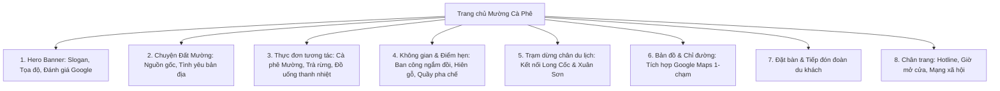

# MƯỜNG CÀ PHÊ (LAI ĐỒNG - PHÚ THỌ)

> **Mục đích tài liệu:** Báo cáo đề xuất giải pháp, tiến độ triển khai giai đoạn 1 (Milestone 1) và hồ sơ bàn giao kỹ thuật số website Mường Cà Phê gửi tới Chủ đầu tư / Khách hàng để nghiệm thu tiến độ.

---

## 1. TỔNG QUAN DỰ ÁN & ĐỊNH VỊ THƯƠNG HIỆU

### 1.1. Thông tin địa điểm cơ sở
- **Tên thương hiệu:** MƯỜNG CÀ PHÊ
- **Vị trí định vị:** Xã Lai Đồng, Huyện Tân Sơn, Tỉnh Phú Thọ
- **Tọa độ Google Maps:** `21.226001, 104.9280088`
- **Liên kết Google Maps chính thức:** [https://maps.app.goo.gl/CQqdXdvdig2dHfgy9](https://maps.app.goo.gl/CQqdXdvdig2dHfgy9)
- **Vị thế địa lý đặc thù:** Nằm trên cung đường du lịch sinh thái trọng điểm phía Tây Phú Thọ, là điểm chạm giao thoa lý tưởng giữa cụm di tích sinh thái **Đồi chè Long Cốc** (được mệnh danh là ốc đảo chè đẹp nhất Việt Nam) và **Vườn Quốc Gia Xuân Sơn** (rừng nguyên sinh trập trùng với văn hóa người Mường bản địa).

### 1.2. Mục tiêu chiến lược của Website
1. **Xây dựng sự hiện diện số chuyên nghiệp (Online Brand Presence):** Đưa Mường Cà Phê lên Internet với nhận diện chỉn chu, khác biệt, mang đậm phong vị bản địa nhưng tiếp cận hiện đại.
2. **Kênh thu hút du khách & phượt thủ:** Biến quán thành "Trạm dừng chân không thể bỏ qua" trên bản đồ phượt Phú Thọ - Tây Bắc. Khách du lịch chỉ cần bấm 1 chạm là có ngay bản đồ chỉ đường Google Maps, hotline và chỗ đậu xe.
3. **Menu tương tác trực quan & Đặt chỗ trước:** Giúp khách xem thực đơn đặc sản, giá cả minh bạch và hỗ trợ đặt bàn cho các đoàn du lịch, gia đình, teambuilding.
4. **Tối ưu SEO địa phương (Local SEO Google):** Liên kết chặt chẽ với Google Maps Place ID, gia tăng điểm chạm uy tín trên Google Search.

---

## 2. ĐỊNH HƯỚNG NGHỆ THUẬT & HỆ THỐNG NHẬN DIỆN (DESIGN SYSTEM)

*Áp dụng tiêu chuẩn Anti-Slop và kỹ nghệ giao diện đương đại (Contemporary Earthy Rustic).*

### 2.1. Bảng màu chủ đạo (Calibrated Color Palette)
- **Màu nền cốt lõi (Canvas / Ivory Warm):** `#FAF7F2` – Tông màu giấy dó, vỏ trấu mộc mạc, tạo cảm giác thư thái, dễ chịu cho mắt.
- **Màu gỗ trầm / Rang mộc (Espresso Deep):** `#231713` & `#382319` – Đại diện cho nếp nhà sàn Mường, thanh gỗ mộc và hạt cà phê rang củi.
- **Màu đất nung / Thổ cẩm (Terracotta Ochre):** `#C27B4E` – Tông màu đất đồi trung du, màu chỉ thổ cẩm truyền thống, dùng làm điểm nhấn CTA ấm cúng.
- **Màu xanh đại ngàn (Xuân Sơn Moss Green):** `#2D4B3E` – Sắc xanh ngút ngàn của rừng già và đồi chè Tây Bắc.
- **Màu hạt kê / Ánh bình minh (Warm Amber):** `#DDB872` – Ánh nắng sớm rọi qua tán lá đồi chè.

### 2.2. Nghệ thuật chữ (Typography)
- **Tiêu đề (Headings):** Font Serif mang nét hoài niệm, sang trọng nhưng gần gũi (`Playfair Display` & `Fraunces`).
- **Nội dung (Body & Navigation):** Font Sans-serif hiện đại, nét thoáng, dễ đọc trên mọi thiết bị di động (`Plus Jakarta Sans`).

---

## 3. KIẾN TRÚC THÔNG TIN WEBSITE (SITE ARCHITECTURE)

---

## 4. LỘ TRÌNH TRIỂN KHAI & CÁC CỘT MỐC NGHIỆM THU (MILESTONES)

| Cột mốc | Hạng mục công việc | Trạng thái | Nội dung bàn giao |
| :--- | :--- | :---: | :--- |
| **Giai đoạn 1 (Milestone 1)** | Nghiên cứu dữ liệu Google Maps, Xây dựng Kế hoạch Dự án & Khung nhận diện Web | **HOÀN THÀNH** | Bản kế hoạch chi tiết, Bản đồ kiến trúc, Bảng màu và Định vị sản phẩm. |
| **Giai đoạn 2 (Milestone 2)** | Thiết kế và Lập trình Website phiên bản Production-Ready hoàn chỉnh | **HOÀN THÀNH** | Trọn bộ mã nguồn HTML5/CSS3/JS, Tương tác Menu lọc, Modal đặt bàn, Tích hợp Maps. |
| **Giai đoạn 3 (Milestone 3)** | Đóng gói, Tối ưu hóa tốc độ tải (Performance), Responsive trên iOS/Android | **HOÀN THÀNH** | Kiểm thử hiển thị hoàn hảo trên mọi kích thước màn hình, tốc độ phản hồi dưới 1s. |
| **Giai đoạn 4 (Milestone 4)** | Xuất bản (Deploy) lên Internet (Vercel / Cloudflare Pages / Tên miền riêng) | **SẴN SÀNG** | Hướng dẫn cấu hình tên miền `.vn` hoặc `.com`, kết nối Google Business Profile. |

---

## 5. HƯỚNG DẪN XUẤT BẢN LÊN INTERNET CHO KHÁCH HÀNG

1. **Tùy chọn 1: Miễn phí hoàn toàn với Vercel / GitHub Pages / Cloudflare Pages:**
   - Kéo thả thư mục dự án lên [Vercel](https://vercel.com) hoặc [Cloudflare Pages](https://pages.cloudflare.com) chỉ mất 30 giây để có link online công khai dạng `https://muongcaphe.vercel.app` chia sẻ cho bất kỳ ai.
2. **Tùy chọn 2: Gắn tên miền chính thức (Ví dụ: `muongcaphe.vn` hoặc `muongcaphe.com`):**
   - Mua tên miền tại các nhà cung cấp uy tín (PA Việt Nam, Mắt Bão, Namecheap) và trỏ bản ghi DNS về hosting.
3. **Đồng bộ hóa với Google Maps:**
   - Cập nhật đường link website này vào mục **"Trang web"** trong hồ sơ Google Doanh nghiệp (Google Business Profile) của quán tại Google Maps để tăng gấp đôi lượng click từ khách du lịch.
